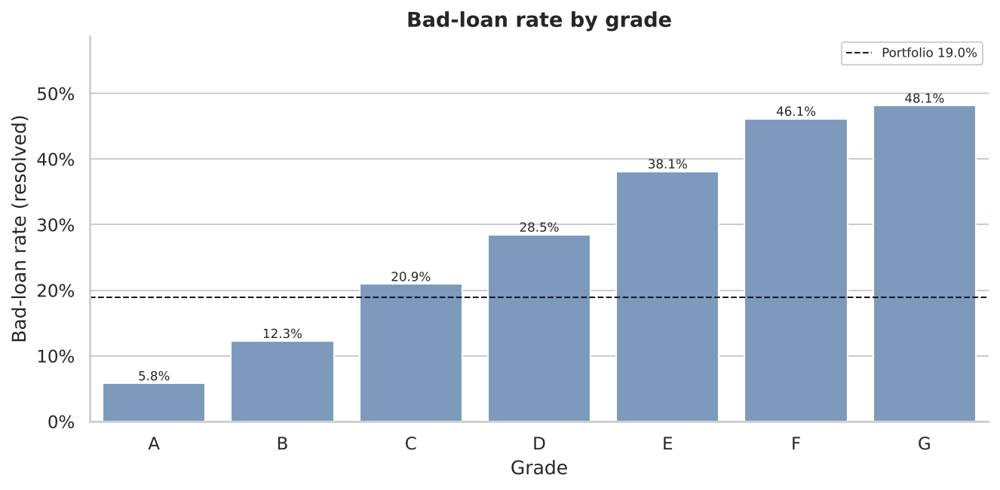
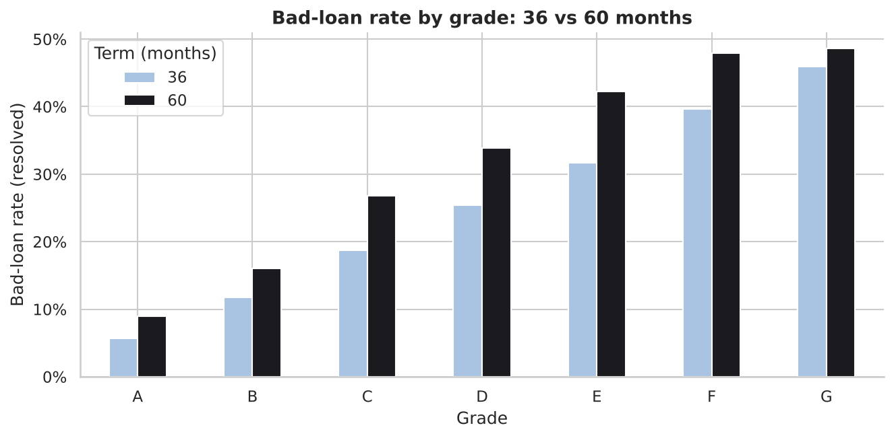
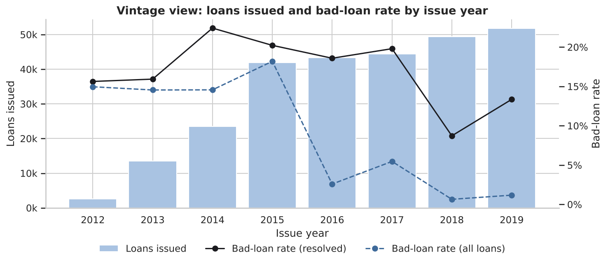

# Goldman Sachs Consumer Finance: Loan Risk EDA in Python

Exploratory data analysis of **270,299 US personal loans** issued between 2012 and 2019. The goal is to clean the data, build risk features, and show what separates loans that are repaid from loans that go bad.

This is Part 3 of my Goldman Sachs Consumer Finance data analytics capstone (Part 1 SQL, Part 2 Power BI, Part 3 Python, Part 4 generative AI).

**Tools:** Python, NumPy, Pandas, Matplotlib, Seaborn

---

## Repository structure

```
GoldmanSachs_python-project/
├── GoldmanSachs_EDA.ipynb        # full notebook with every output and chart
├── data/
│   ├── loan.csv.zip.part00-05    # 270,299 loans, zipped and split into parts
│   ├── customer.csv.zip.part00-04# 270,299 borrowers, zipped and split into parts
│   └── state_region.csv          # state to subregion and region lookup
├── images/                       # the 24 charts the notebook saves
└── outputs/
    └── EDA_Summary.pdf           # one-page summary of the five strongest risk drivers
```

The raw CSVs are too large for GitHub's browser upload, so they are zipped and split into numbered parts. The first code cell of section 1 joins the parts back into `loan.csv.zip` and `customer.csv.zip`, and Pandas reads the zips directly, so there is nothing to unzip by hand. Clone the repo and run the notebook top to bottom. The last cell writes the cleaned data to `outputs/loans_clean.csv.zip` (270,299 rows, 38 columns).

---

## Metric definitions

| Metric | Definition |
|---|---|
| Bad loan | Status is Charged Off or Default |
| Resolved loan | Fully Paid, Charged Off or Default (the loan has finished) |
| Bad-loan rate | Bad loans ÷ resolved loans |
| Delinquent loan | In Grace Period, Late (16-30 days) or Late (31-120 days) |
| Payment-to-income (PTI) | Installment × 12 ÷ annual income |
| Scheduled interest | Installment × term months − funded amount |
| High-risk borrower | Grade E to G, or PTI above 15%, or currently delinquent |

Every bad-loan rate uses **resolved loans only**. 63% of loans are still Current and have not had time to fail, so using all loans would show 6.6% instead of the true 19.0%.

---

## What the notebook does

1. **Load and merge** loan, customer and state_region. All 270,299 rows are kept, and every loan finds a customer and a region.
2. **Data-quality audit** of every column (type, nulls, null %, unique values). 16 issues found and fixed, including a repeated header row in state_region, five spellings of three loan types, text terms like " 36 months", and incomes from $34 to $9.55M.
3. **Cleaning:** dates converted, job titles standardised, employment length turned into years, and constant or duplicate columns dropped. Income outliers are capped at the 1st and 99th percentile in a separate column (the IQR rule would have cut 5% of borrowers, most of them real high earners).
4. **Feature creation:** bad, resolved, delinquent and NPL flags, PTI and PTI band, income band, issue month, scheduled interest and a high-risk flag.
5. **Univariate analysis:** distributions of loan amount, interest rate, income (log scale) and PTI; counts by grade, purpose, term and status.
6. **Bivariate and multivariate analysis:** rate by grade, bad-loan rate by six factors, a grade × term heatmap, a correlation heatmap and a vintage view by issue year.
7. **Five statements tested** with pivot tables and charts.
8. **Export** of `loans_clean.csv` for Part 4.

Every chart has a title, labelled axes and a one-line observation below it.

---

## Key insights

### The five strongest drivers of bad loans

| # | Driver | Safest | Riskiest |
|---|---|---|---|
| 1 | Grade | A: 5.8% | G: 48.1% |
| 2 | Loan term | 36 months: 15.0% | 60 months: 31.4% |
| 3 | Purpose | Car: 13.2% | Small business: 27.2% |
| 4 | Payment-to-income | Under 5%: 12.8% | 15-20%: 26.4% |
| 5 | Annual income | $100k+: 14.8% | Under $45k: 22.6% |



### Five statements tested

| Statement | Verdict | Proof |
|---|---|---|
| 60-month loans go bad more often within the same grade | Holds | Higher in all 7 grades; grade C 26.8% vs 18.8% |
| Bad-loan rate falls steadily as income rises | Holds | 22.6% down to 14.8%, lower at every step |
| Small business is the riskiest purpose | Holds | 27.2%, top of 13 purposes |
| Higher PTI means higher risk at every level | Partly | Rises to 26.4% at 15-20%, then dips to 24.6% above 20% |
| Region makes little difference once grade is known | Holds | 3.4-point gap across regions vs 42 points across grades |



### Why the resolved base matters

On all loans, 2018 looks almost risk-free at 0.6%. On finished loans it is 8.7%. Newer loans have simply not had time to fail.



---

## Recommendations

- Cap or reprice 60-month loans for grades D to G, where the bad-loan rate is 34% to 49%.
- Set a PTI limit near 15%. Risk stops rising above that line, and only 8.2% of loans sit above it.
- Tighten small-business lending and grow car and credit card loans, the safest large purposes.

---

**Author:** Swapnil Mukhopadhyay, PGDM (Batch 2025-27), New Delhi Institute of Management
